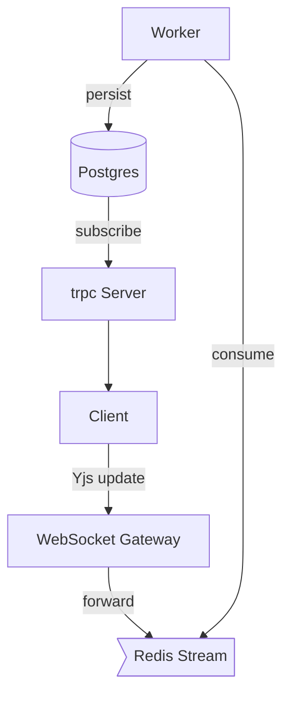

# Collaboration Feature Specification

## 1. Overview

This document captures the functional & technical requirements for **real-time collaboration** in GlassChat.

> Status: _Draft v0.1 – work-in-progress_

## 2. Goals

1. Allow multiple authenticated users to view & edit the same conversation **live**.
2. Provide presence indicators (who is online & where they are typing).
3. Achieve <200 ms latency for text updates in North America / EU.
4. Maintain eventual consistency – no message loss, no ghost duplicates.
5. Work offline & sync when connectivity is restored.

## 3. User Stories

| #   | As a…       | I want to…                               | So that…                               |
| --- | ----------- | ---------------------------------------- | -------------------------------------- |
| 1   | Participant | See when others are typing               | I know someone is preparing a response |
| 2   | Participant | Watch messages appear in real-time       | The chat feels alive                   |
| 3   | Participant | Edit my last message within 2 min        | Fix typos quickly                      |
| 4   | Moderator   | Remove inappropriate messages            | Keep discussions safe                  |
| 5   | New user    | Join an ongoing chat & load last 50 msgs | Get context fast                       |

## 4. Functional Requirements

### 4.1 Presence

- Show **avatar + coloured cursor/selection** for each connected user.
- Idle after 60 s of no interaction; offline after 30 s ping timeout.

### 4.2 Message Sync

- Ops are transmitted via CRDT (Yjs) over WebSocket.
- Each op carries logical clock (Lamport) & userId.
- Server stores canonical log in Redis Stream (maxlen ~10 k per room).

### 4.3 Permissions

- `author` may edit/delete own message within grace period.
- `moderator` may edit/delete any message.
- `viewer` read-only.

## 5. Non-Functional Requirements

- **Security**: Auth via NextAuth JWT; messages encrypted in-transit (TLS).
- **Scalability**: Horizontal across 3 WebSocket nodes; sticky sessions via Redis.
- **Accessibility**: WCAG AA for colour & keyboard nav.

## 6. Technical Architecture



### 6.1 Packages & Services

- **Yjs** – CRDT engine in browser & server workers.
- **@trpc/server** – query/messages history.
- **Redis** – pub/sub & stream log.
- **Postgres** – durable storage.

## 7. API Design (tRPC)

| Route           | Method       | Input                | Output                  |
| --------------- | ------------ | -------------------- | ----------------------- |
| `collab.join`   | mutation     | `{roomId}`           | `{clientId, history[]}` |
| `collab.update` | subscription | `void` (server push) | `{updates[]}`           |
| `collab.leave`  | mutation     | `void`               | `void`                  |

## 8. UI/UX

- Chat message list rewrites to **optimistic** UX; pending msgs gray.
- Colored borders for active users (max 6 unique colours → cycle).
- Toast when connectivity lost/restored.

## 9. Data Model (Prisma)

```prisma
model ChatRoom {
  id          String   @id @default(cuid())
  title       String
  createdAt   DateTime @default(now())
  messages    Message[]
  memberships Membership[]
}

model Message {
  id        String   @id @default(cuid())
  roomId    String
  authorId  String
  body      String
  createdAt DateTime @default(now())
  updatedAt DateTime?
  ChatRoom  ChatRoom @relation(fields: [roomId], references: [id])
}

model Membership {
  userId   String
  roomId   String
  role     Role @default(VIEWER)
  joinedAt DateTime @default(now())
  @@id([userId, roomId])
}

enum Role {
  VIEWER
  PARTICIPANT
  MODERATOR
}
```

## 10. Open Questions

1. Do we need message reactions? (👍, ❤️ …)
2. Should edits be versioned or overwritten?
3. Mobile push notifications – out of scope for MVP?

---

_End of v0.1 draft – please add comments inline or in GitHub issues._
